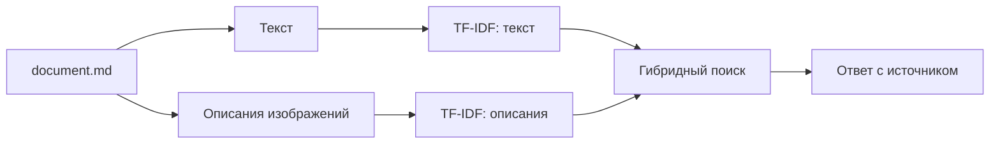

# MM-RAG Visual

Мультимодальная RAG-система: поиск по тексту и изображениям из документов.

## Идея
Обычный RAG ищет только по тексту. Но в реальных документах половина информации — это диаграммы, таблицы и графики. MM-RAG извлекает и текст, и изображения, генерирует для каждого изображения текстовое описание через мультимодальную LLM, а затем ищет по обоим типам данных.

## Что внутри
- data/document.md — демо-документ с текстом и описаниями картинок.
- src/mm_rag.py — скрипт извлечения, индексации и поиска.
- results/answers.txt — примеры ответов.

## Архитектура
1. Извлечение: текст + изображения.
2. Описание: для каждого изображения генерируется текст.
3. Индексация: TF-IDF по тексту + TF-IDF по описаниям.
4. Поиск: гибридный (текст + картинки).
5. Генерация: ответ с указанием источника.

## Как запустить
python3 src/mm_rag.py

## Автор
redsea1970

## Оценка

Проект — демонстрация MM-RAG, а не production-система. Оценка полноты:
- Модальности: текст + изображения (описания в `data/document.md`).
- Поиск: TF-IDF по тексту + TF-IDF по описаниям.
- Генерация: ответ с указанием источника.
- Примеры ответов: `results/answers.txt`.

## Ограничения
- «Изображения» хранятся как текстовые описания в `document.md`, а не как реальные файлы.
- Нет мультимодальной LLM: описания сгенерированы вручную/шаблоном, а не моделью.
- Для production нужно: подключить CLIP/LLaVA для эмбеддингов изображений, векторную БД, гибридный поиск (RRF).

## Архитектура

## Архитектура

Подробная схема проекта: [ARCHITECTURE.md](ARCHITECTURE.md)
